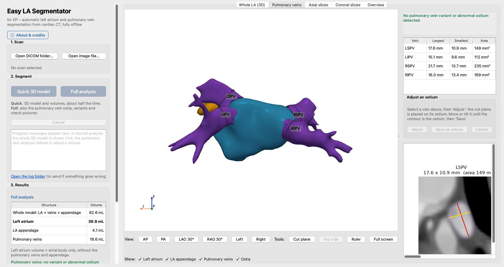
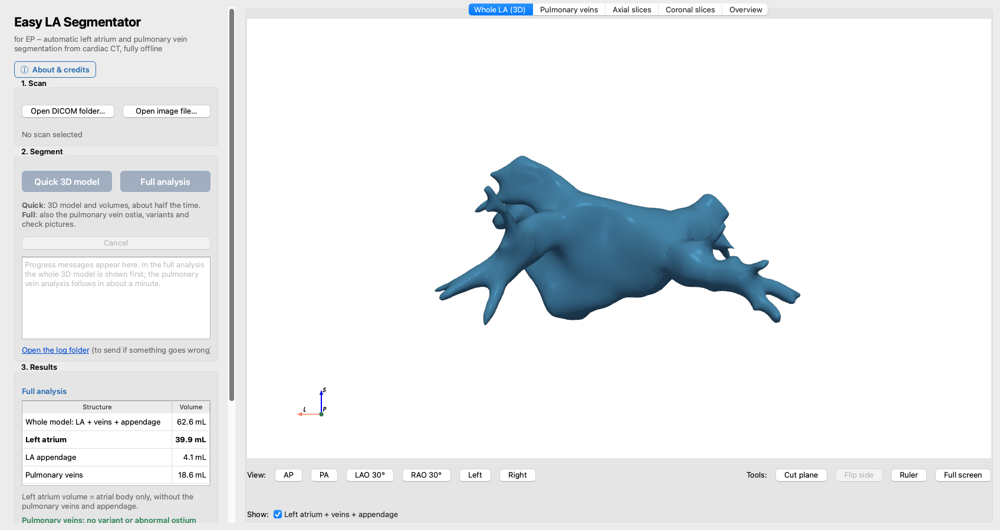
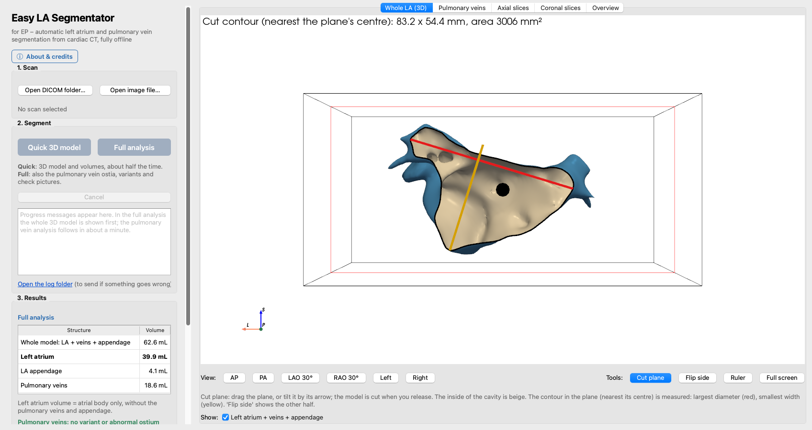
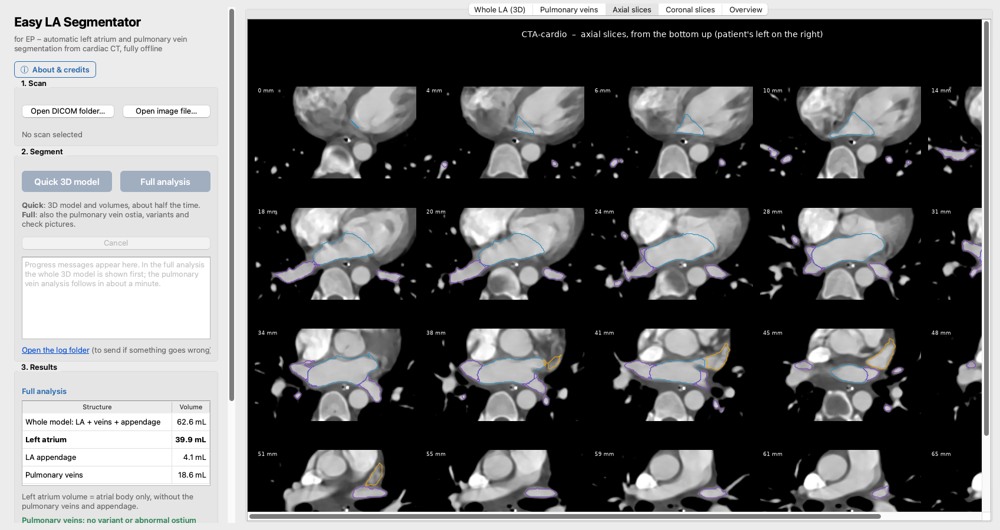

# Easy LA Segmentator

**Automatic 3D model of the left atrium, pulmonary veins and left atrial appendage from cardiac CT, for
electrophysiologists. Runs fully offline on your own computer.**

> **Research use only. Not a medical device.** The segmentations and measurements may be wrong: always check them on
> the CT images.

## Download

**[Latest release](../../releases/latest)**

| | Windows | macOS |
|---|---|---|
| File | `Easy LA Segmentator-<version>-Setup.exe` (1.4 GB) | `Easy LA Segmentator-<version>-macOS.dmg` (1.4 GB) |
| System | Windows 10 (1809+) or 11, 64-bit; 8 GB memory at least (16 GB better) | macOS 14 or later, Apple silicon (M1 or later); 16 GB memory |
| Install | Run Setup.exe: no administrator rights needed (installs for the current user) | Drag the app to Applications |
| Speed | On the processor: full analysis about 10 min on a hospital PC, quick 3D model about half | On the Mac's GPU: 1–2 min |

Everything the app needs is inside the installer (its own Python, the libraries and the AI models): nothing is
downloaded when it runs. `SHA256SUMS.txt` in the release lets you check a downloaded file.

The installers are not signed by a registered developer. Windows SmartScreen asks once ("More info" > "Run anyway");
macOS asks once (System Settings > Privacy & Security > "Open Anyway"). Your hospital's IT may need to allow it.

## Your free licence key (once)

The left atrium model (TotalSegmentator's *heartchambers_highres*) is free for non-commercial use but needs your own
licence key:

1. Fill in the short form at **https://backend.totalsegmentator.com/license-academic/** (from any computer).
2. You receive your personal key (18 characters, `aca_…`).
3. Enter it when the app asks, at the first segmentation. It stays on your computer and is checked offline.

## Privacy

- Everything runs on your computer: no internet connection is needed, and **no image or patient data ever leaves the
  machine**.
- TotalSegmentator's anonymous usage statistics are turned off.
- The log files the app writes (for troubleshooting) never contain the scan's name or path.

## What it does

1. **Open a cardiac CT**: a DICOM folder, or a NIfTI/NRRD file. In a multi-phase series the end-systolic phase
   (40–45% of the R-R interval, when the left atrium is largest) is used.
2. **Choose a mode**:
   - **Quick 3D model**: the left atrium with its veins and appendage as a 3D model, with the volumes. The fastest
     reliable result, about half the time of the full analysis.
   - **Full analysis**: also each pulmonary vein. The veins are named, and each ostium is measured (largest and
     smallest diameter, area). Variants are flagged: common trunk, accessory or middle vein, small or large ostium.
     You also get axial and coronal review sheets. A quick result can be completed later without running the AI
     again.
3. **Look and measure** in 3D:
   - EP views: AP, PA, LAO, RAO, left, right.
   - A cut plane that shows the inside of the cavity and measures the contour.
   - A ruler.
   - Semi-automatic adjustment of an ostium.
4. **Export**:
   - STL files and the volumes.
   - Files for EP mapping systems:
     - VTK surfaces for CARTO 3 and OPAL HDx.
     - A pre-segmented DICOM series for EnSite X (through EnSite Verismo), and as a second route for OPAL HDx and
       CARTO 3.

     A *How to import* note comes with them. *The mapping-system import has not yet been tested on the systems
     themselves: please try it with a test case first, and tell us how it went.*

The **left atrium volume** is the atrial body, without the pulmonary veins and appendage. The model also gives one
combined shell (atrium + veins + appendage), e.g. for a mapping system.

| Whole left atrium | Cut plane | Review slices |
|---|---|---|
|  |  |  |

*(Screenshots: the public CTA-cardio sample scan from 3D Slicer.)*

## Check that it works on your computer

The self-test segments a public sample scan (no patient data) in both modes and compares the result with the reference.
It ends with "all checks passed" and the time each mode took on your computer.

- **Windows:** run it from the Start menu: "Easy LA Segmentator self-test".
- **macOS:** run this in Terminal:
  `"/Applications/Easy LA Segmentator.app/Contents/MacOS/Easy LA Segmentator" --selftest --console`

It first asks for your licence key if the app does not have it yet.

## How it works and how it was tested

The AI segmentation is done by [TotalSegmentator](https://github.com/wasserth/TotalSegmentator):
- its high-resolution heart chamber model draws the left atrium;
- its whole-body model draws the pulmonary veins and the appendage.

The app then:
- corrects the atrial border on the CT itself (the blood-pool edge);
- joins the atrium and the veins;
- follows the veins further into the lungs;
- places the atrium/vein border;
- measures each ostium on the 3D surface.

- **27 public cardiac CT scans with expert outlines of the left atrium** (HOCMvalvesSeg). Medians: Dice 0.93, 99.4%
  of the atrium inside the experts' outline, wall offset −0.2 mm. The quick mode gives the same agreement (Dice 0.93,
  99.3%).
- **Anonymized hospital CT examinations**, reviewed on the images. These included late-phase series with low contrast
  in the atrium; the app warns when a series has low contrast.
- **Limits:** the pulmonary vein names and ostia were checked visually, not against expert measurements; small
  accessory veins can be missed.

## Credits

- **TotalSegmentator:** Wasserthal J. et al., *TotalSegmentator: robust segmentation of 104 anatomic structures in CT
  images*, Radiology: Artificial Intelligence 2023, doi:10.1148/ryai.230024. We thank Dr Jakob Wasserthal for his
  permission to distribute the TotalSegmentator models with this app.
- **nnU-Net**, the AI framework behind TotalSegmentator: Isensee F. et al., Nature Methods 2021.
- **Public datasets used for development and testing:**
  - HOCMvalvesSeg: Zheng et al., PMLR vol. 222 (2024), CC BY-NC 4.0. Original voxel sizes kindly provided by Dr
    Xiaowei Xu.
  - CTA-cardio sample: 3D Slicer sample data.
- **Software:** PyTorch, SimpleITK, scikit-image, SciPy, NumPy, PyVista / VTK, Qt (PySide6), matplotlib.

Conceptualization and vibe coding: Dr Mikael Laredo, Hôpital Pitié-Salpêtrière, APHP, Sorbonne Université, Paris,
France. Code: Claude (Anthropic).

If you use Easy LA Segmentator in a study, please cite TotalSegmentator (above).

## Terms of use

- Free for non-commercial research use.
- Easy LA Segmentator is not a medical device and comes without any warranty.
- The *heartchambers_highres* model is licensed by the TotalSegmentator authors for non-commercial use only. Each
  user needs their own licence key.
- The other libraries included are each under their own licence; the texts are in the app's `licenses` folder.

Questions, problems, or a report from your mapping system: please open an
[issue](../../issues).
